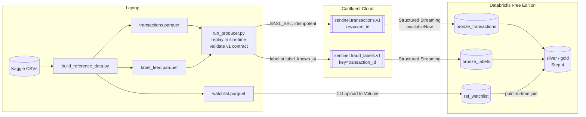

# Sentinel — Capacity-Aware Fraud Detection & Investigation Platform

> End-to-end fraud detection: Kafka → Databricks medallion → XGBoost scoring →
> capacity-constrained alerting → LLM investigation copilot.

**Business question:** How can a financial institution identify suspicious
transactions quickly while keeping the number of unnecessary investigations manageable?

_Headline results go here once the model is evaluated on the held-out test set
(e.g. "At 100 alerts/day, Sentinel catches X% of fraud dollars with Y false
positives per 1,000 transactions")._

---

## Status

| Step | Component | Status |
|---|---|---|
| 1 | Data selection & design | ✅ |
| 2 | Data layer: download, canonical schema, label lag, watchlist, event contract, profile | ✅ |
| 2b | Watchlist redesign after profiling (one ~2-day fraud burst per card → fast hot-list) | ✅ |
| 3 | Kafka producer → Databricks bronze | ✅ |
| 4 | Silver / gold (point-in-time features, watchlist join) | ⏳ next |
| 5 | Models: logistic regression baseline vs XGBoost (MLflow) | |
| 6 | Business evaluation: PR-AUC, recall@capacity, cost, CIs | |
| 7 | Alerting (email) + FastAPI batch scoring | |
| 8 | Investigation dashboard (Streamlit) | |
| 9 | GenAI investigation assistant (RAG over SOPs) + eval | |
| 10 | Monitoring, drift, CI/CD | |

## Architecture



## Data

**Primary:** Sparkov synthetic credit-card transactions (Kaggle `kartik2112/fraud-detection`),
~1.85M transactions, Jan 2019 – Dec 2020, ~1,000 cards, 14 merchant categories, ~0.5% fraud.
Synthetic data: patterns are cleaner than real life, and results should be read that way.
Profiling showed nearly every card (976 of ~983) is compromised exactly once, in a burst of
~10 frauds over ~2 days — so "card had fraud before" is useless, while catching the
*early* part of a burst is where detection pays off.

Source quirks handled in `src/sentinel/data/loader.py`:
- `unix_time` does not match `trans_date_trans_time`; the latter is used as event time.
- Merchant names all start with `fraud_`; the prefix is stripped.
- Name/street PII dropped; card numbers replaced with pseudonymous `card_…` ids; `dob` → age.

**Synthetic supplements** (all generated from `config/assumptions.yaml`):

| Table | Why it exists | Leakage guard |
|---|---|---|
| `label_feed` | Labels arrive late via two channels: customer reports (2–72 h, ~60%) and chargebacks (15–60 days) | Consumers filter `label_known_at <= as_of` |
| `watchlist` | Card hot-list (hours after a fraud report, 14-day TTL), scheduled merchant-risk reviews (trailing 90-day rate ≥ 5× baseline), plus noisy external listings | Built only from labels known at listing time; `added_at >= evidence_known_at`; point-in-time join |
| `assumptions.yaml` | Capacity, investigation cost, loss rates, split dates | Single source for every business number |

**Chronological split**

| Split | Period | Use |
|---|---|---|
| train | 2019-01 → 2020-02 | fit |
| gap | 2020-03 | absorbs label lag; unused |
| valid | 2020-04 → 2020-06 | threshold / capacity tuning |
| test | 2020-07 → 2020-12 | final metrics (bootstrap CIs) + drift window |

**Kafka contract** (`src/sentinel/common/events.py`, JSON Schemas in `schemas/`):
- `sentinel.transactions.v1` — `TransactionEvent`, keyed by `card_id`; **no label field** (validation rejects one).
- `sentinel.fraud_labels.v1` — `FraudLabelEvent`, arrives later with `label_known_at`.

## Quick start

```bash
python -m venv .venv && source .venv/bin/activate
pip install -e ".[dev,kaggle,stream]"

# Real data (needs ~/.kaggle/kaggle.json)
python scripts/download_data.py
python scripts/build_reference_data.py
python scripts/profile_data.py          # -> docs/data_profile.md

# Offline / CI: small mock sample in the same raw format
python scripts/make_mock_data.py
python scripts/build_reference_data.py --mock

pytest -q
```

## Runbook: streaming into bronze (Step 3)

One-time setup:
1. Confluent Cloud: cluster `sentinel-dev` (Basic, AWS us-east-1), topics
   `sentinel.transactions.v1` (6 partitions) and `sentinel.fraud_labels.v1` (3), both 7-day retention.
   Service accounts: `sentinel-producer` (WRITE/DESCRIBE + IDEMPOTENT_WRITE) and
   `sentinel-databricks` (READ/DESCRIBE + consumer group prefix `sentinel-`).
2. `cp .env.example .env` and fill in the bootstrap server and **producer** key/secret.
3. Databricks secret scope `sentinel` with `kafka-bootstrap`, `kafka-consumer-key`,
   `kafka-consumer-secret` (the **Databricks** key).

Each run:

```bash
pip install -e ".[dev,stream]"
scripts/deploy_notebooks.sh                      # import notebooks to /Users/<you>/sentinel
# In Databricks: run 00_setup once
scripts/upload_reference.sh                      # watchlist -> landing volume
# In Databricks: run 02_load_reference

# Backfill history (train + gap + valid) as fast as possible (~1.3M events)
python scripts/run_producer.py --start 2019-01-01 --end 2020-07-01 --speed max
# In Databricks: run 01_bronze_ingest  (availableNow; rerun any time to pick up new events)

# "Live" test period: 1 simulated day every 10 seconds (~30 min for 6 months)
python scripts/run_producer.py --start 2020-07-01 --end 2021-01-01 --speed 1d/10s
```

Notes
- Replays are safe: bronze keeps duplicates; silver de-duplicates on `transaction_id`.
- Bronze never drops rows. Problems are listed in `dq_errors`
  (`unparseable_json`, `bad_amount`, `key_mismatch`, `label_leak`, …) and `is_test` marks
  `TEST-*` messages; silver decides what to keep.
- Topic retention is 7 days: run `01_bronze_ingest` at least weekly (or schedule it as a Job).
- `python scripts/run_producer.py --sink file --max-events 10000` is a dry run with no Kafka.

## Repo layout

```
config/assumptions.yaml      business numbers, split dates, watchlist & label-lag settings
src/sentinel/common/         config loader, Kafka event contracts
src/sentinel/data/           loader, label feed, watchlist, mock generator
src/sentinel/streaming/      Kafka producer (sim-time replay) and sinks (Kafka / file / memory)
notebooks/databricks/        00_setup, 01_bronze_ingest, 02_load_reference
scripts/                     download, build reference data, profile, producer, deploy/upload
schemas/                     JSON Schemas for Kafka topics
docs/                        data profile, SOPs (for the GenAI assistant)
tests/                       leakage, contract, producer and bronze-transform tests (local Spark)
.github/workflows/ci.yml     lint + tests + mock smoke run + producer dry run
```
