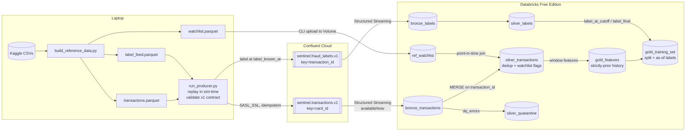

# Sentinel — Capacity-Aware Fraud Detection & Investigation Platform

> End-to-end fraud detection: Kafka → Databricks medallion → XGBoost scoring →
> capacity-constrained alerting → LLM investigation copilot.

**Business question:** How can a financial institution identify suspicious
transactions quickly while keeping the number of unnecessary investigations manageable?

## Results (held-out test period, Jul–Dec 2020)

With a review team sized for **20 alerts/day**, the XGBoost champion caught **89% of fraud
(95% CI 86–92%) and 93% of fraud dollars**, with **67% of alerts being real fraud** and
1.7 false positives per 1,000 transactions, for an estimated **$575k net benefit**
(CI $510k–$635k) over doing nothing. The rules-only watchlist with the same budget caught
20%; the logistic-regression baseline caught 69%.

| Strategy (20 alerts/day) | Fraud caught | Alert precision | $ caught | Net benefit |
|---|---|---|---|---|
| Watchlist rule (top 20 by amount) | 20.4% | 11.1% | 29.1% | $103k |
| Logistic regression baseline | 68.8% | 49.9% | 84.3% | $524k |
| **XGBoost champion** | **89.3%** | **66.8%** | **93.0%** | **$575k** |
| XGBoost, no daily cap (overtime) | 96.5% | 63.3% | 98.9% | $603k |

What the numbers say:
- **Team size has a sweet spot.** Net benefit peaks at 20–25 alerts/day; beyond that, extra
  reviews mostly land on legitimate customers (at 100/day precision falls to 12%).
- **The bottleneck is busy days, not the model.** Fraud arrives in bursts: on 49 of 184 days
  the fixed threshold produced more than 20 alerts, and capping review left 145 frauds
  unreviewed. Without the cap the same model catches 96.5% at 16.7 alerts/day on average, so
  a backlog queue or flexible peak-day staffing should recover much of that gap (tested in
  Step 7).
- **Protected attributes are excluded** from the model at a cost of 0.004 validation PR-AUC.
  Alert and false-positive rates stay within 0.8–1.25 of the overall rate for every gender and
  age group; recall is lower for women (85% vs. 94%), which is flagged for monitoring.
- Synthetic data (Sparkov) makes absolute numbers optimistic; the method is the point.

Full report: [`docs/results.md`](docs/results.md).

---

## Status

| Step | Component | Status |
|---|---|---|
| 1 | Data selection & design | ✅ |
| 2 | Data layer: download, canonical schema, label lag, watchlist, event contract, profile | ✅ |
| 2b | Watchlist redesign after profiling (one ~2-day fraud burst per card → fast hot-list) | ✅ |
| 3 | Kafka producer → Databricks bronze | ✅ |
| 4 | Silver / gold (point-in-time features, watchlist join) | ✅ |
| 5 | Models: logistic regression baseline vs XGBoost (MLflow) | ✅ |
| 6 | Business evaluation: PR-AUC, recall@capacity, cost, CIs | ✅ |
| 7 | Alerting (email) + FastAPI batch scoring | ⏳ next |
| 8 | Investigation dashboard (Streamlit) | |
| 9 | GenAI investigation assistant (RAG over SOPs) + eval | |
| 10 | Monitoring, drift, CI/CD | |

## Architecture



## Data

**Primary:** Sparkov synthetic credit-card transactions (Kaggle `kartik2112/fraud-detection`),
~1.85M transactions, Jan 2019 – Dec 2020, ~1,000 cards, 14 merchant categories, ~0.5% fraud.
Synthetic data: patterns are cleaner than real life, and results should be read that way.
Profiling showed nearly every card (976 of ~983) is compromised exactly once, in a burst of
~10 frauds over ~2 days — so "card had fraud before" is useless, while catching the
*early* part of a burst is where detection pays off.

Source quirks handled in `src/sentinel/data/loader.py`:
- `unix_time` does not match `trans_date_trans_time`; the latter is used as event time.
- Merchant names all start with `fraud_`; the prefix is stripped.
- Name/street PII dropped; card numbers replaced with pseudonymous `card_…` ids; `dob` → age.

**Synthetic supplements** (all generated from `config/assumptions.yaml`):

| Table | Why it exists | Leakage guard |
|---|---|---|
| `label_feed` | Labels arrive late via two channels: customer reports (2–72 h, ~60%) and chargebacks (15–60 days) | Consumers filter `label_known_at <= as_of` |
| `watchlist` | Card hot-list (hours after a fraud report, 14-day TTL), scheduled merchant-risk reviews (trailing 90-day rate ≥ 5× baseline), plus noisy external listings | Built only from labels known at listing time; `added_at >= evidence_known_at`; point-in-time join |
| `assumptions.yaml` | Capacity, investigation cost, loss rates, split dates | Single source for every business number |

**Chronological split**

| Split | Period | Use |
|---|---|---|
| train | 2019-01 → 2020-02 | fit |
| gap | 2020-03 | absorbs label lag; unused |
| valid | 2020-04 → 2020-06 | threshold / capacity tuning |
| test | 2020-07 → 2020-12 | final metrics (bootstrap CIs) + drift window |

**Kafka contract** (`src/sentinel/common/events.py`, JSON Schemas in `schemas/`):
- `sentinel.transactions.v1` — `TransactionEvent`, keyed by `card_id`; **no label field** (validation rejects one).
- `sentinel.fraud_labels.v1` — `FraudLabelEvent`, arrives later with `label_known_at`.

## Quick start

```bash
python -m venv .venv && source .venv/bin/activate
pip install -e ".[dev,kaggle,stream]"

# Real data (needs ~/.kaggle/kaggle.json)
python scripts/download_data.py
python scripts/build_reference_data.py
python scripts/profile_data.py          # -> docs/data_profile.md

# Offline / CI: small mock sample in the same raw format
python scripts/make_mock_data.py
python scripts/build_reference_data.py --mock

pytest -q
```

## Runbook: streaming into bronze (Step 3)

One-time setup:
1. Confluent Cloud: cluster `sentinel-dev` (Basic, AWS us-east-1), topics
   `sentinel.transactions.v1` (6 partitions) and `sentinel.fraud_labels.v1` (3), both 7-day retention.
   Service accounts: `sentinel-producer` (WRITE/DESCRIBE + IDEMPOTENT_WRITE) and
   `sentinel-databricks` (READ/DESCRIBE + consumer group prefix `sentinel-`).
2. `cp .env.example .env` and fill in the bootstrap server and **producer** key/secret.
3. Databricks secret scope `sentinel` with `kafka-bootstrap`, `kafka-consumer-key`,
   `kafka-consumer-secret` (the **Databricks** key).

Each run:

```bash
pip install -e ".[dev,stream]"
scripts/deploy_notebooks.sh                      # import notebooks to /Users/<you>/sentinel
# In Databricks: run 00_setup once
scripts/upload_reference.sh                      # watchlist -> landing volume
# In Databricks: run 02_load_reference

# Backfill history (train + gap + valid) as fast as possible (~1.3M events)
python scripts/run_producer.py --start 2019-01-01 --end 2020-07-01 --speed max
# In Databricks: run 01_bronze_ingest  (availableNow; rerun any time to pick up new events)

# In Databricks: run 03_silver, then 04_gold_features

# Rest of the data (test period + every label that matures after July 2020)
python scripts/run_producer.py --start 2020-07-01 --speed max
# In Databricks: 01_bronze_ingest -> 03_silver -> 04_gold_features -> 05_train_models -> 06_evaluate
```

Notes
- Replays are safe: bronze keeps duplicates; silver de-duplicates on `transaction_id`.
- Bronze never drops rows. Problems are listed in `dq_errors`
  (`unparseable_json`, `bad_amount`, `key_mismatch`, `label_leak`, …) and `is_test` marks
  `TEST-*` messages; silver decides what to keep.
- Topic retention is 7 days: run `01_bronze_ingest` at least weekly (or schedule it as a Job).
- `python scripts/run_producer.py --sink file --max-events 10000` is a dry run with no Kafka.
- Notebooks are synced from GitHub through a Databricks **Git folder**
  (`/Users/<you>/sentinel-fraud-platform`); after a push, open it and click **Pull**.
  `scripts/deploy_notebooks.sh` remains as a CLI alternative.

## Silver and gold (Step 4)

- `03_silver` streams bronze (`availableNow`) and `MERGE`s on `transaction_id`, so reruns and
  Kafka replays are idempotent. Invalid rows go to `silver_quarantine` with their `dq_errors`.
  The watchlist is joined point-in-time (`added_at <= event_ts < removed_at`).
- `04_gold_features` builds features from each card's **strictly earlier** transactions and
  writes `gold_training_set` with two label views: `label_at_cutoff` (known by the end of the
  gap month; used for training) and `label_final` (everything known now; evaluation only).
  Feature definitions: [`docs/features.md`](docs/features.md).
- Leakage is tested, not just claimed: CI runs the notebook code on local Spark and checks
  (1) Spark features equal an independent pandas implementation and (2) perturbing future
  transactions leaves every earlier row's features unchanged.

## Models (Step 5)

`05_train_models` (Databricks) and `scripts/train_local.py` (laptop) run the same code
from `src/sentinel/models/`:

| Experiment | Model | Features |
|---|---|---|
| `logreg_full` / `logreg_no_watchlist` | L2 logistic regression on log-scaled, standardised features | with / without watchlist |
| `xgb_full_d4`, `_d6`, `_d8` | XGBoost, early stopping on validation PR-AUC | full |
| `xgb_no_watchlist` | XGBoost | without watchlist (ablation) |

- **Train:** `train` split, `label_at_cutoff`; negatives down-sampled to 25% with weight 4 so
  probabilities keep their original scale.
- **Select:** `valid` split, `label_final`, by PR-AUC. Also reported: recall/precision at a
  daily review budget of 100 and 25 alerts, both as each day's top-K (upper bound) and with a
  single fixed threshold fitted on validation (what a live system can do), plus false
  positives per 1,000 transactions and share of fraud *dollars* caught.
- **Track:** every run in MLflow (params, metrics, PR curve, feature importance, model with
  signature). Best PR-AUC is registered in Unity Catalog as `fraud_model@champion`; best
  logistic regression as `fraud_model@baseline`, with capacity thresholds as version tags.
- **Untouched:** the `test` split is first used in Step 6.
- **Protected attributes** (`gender`, `age_at_txn`) are never model inputs; they stay in gold
  only for the fairness check in Step 6.
- **Readable baseline:** the logistic regression gets one non-overlapping version of each
  signal and drop-first one-hot encoding, so each coefficient is "effect vs. a reference".
- **Champion rule:** the simplest model within 0.001 validation PR-AUC of the best.

## Business evaluation (Step 6)

`06_evaluate` scores the untouched test months (Jul–Dec 2020) with `fraud_model@champion`
and `@baseline`. Results: [`docs/results.md`](docs/results.md).

- **Capacity curve.** For 5–100 alerts/day: recall, precision, share of fraud dollars caught,
  false positives per 1,000 transactions and net benefit. Two policies: *deployable* (one
  threshold fitted on validation, at most K reviewed per day) and *daily top-K* (upper bound).
- **Operating budget** = the K with the highest net benefit (ties → smaller team).
- **Strategy comparison** at that budget: no model, watchlist rule (all hits / top-K by
  amount), logistic regression, XGBoost (capped, uncapped "overtime", top-K).
- **Cost model** from `config/assumptions.yaml`: review, escalation and customer-friction
  costs vs. fraud losses net of recovery; net benefit is measured against doing nothing.
- **Uncertainty:** 95% intervals from a day-level bootstrap (whole days resampled, so bursts
  and busy days stay intact).
- **Busy days:** how often the fixed threshold overflows the budget and how much fraud the
  cap costs.
- **Fairness:** alert rate, recall and false-positive rate by gender and age band, with
  ratios to the overall rate (protected attributes are *not* model inputs).
- Outputs: `gold_eval_*` tables, `gold_scores` (feeds dashboard and alerts), an MLflow run
  with the Markdown report and plot, and `operating_k` / `operating_threshold` tags on the
  champion model version.

## Repo layout

```
config/assumptions.yaml      business numbers, split dates, watchlist & label-lag settings
src/sentinel/common/         config loader, Kafka event contracts
src/sentinel/data/           loader, label feed, watchlist, mock generator
src/sentinel/streaming/      Kafka producer (sim-time replay) and sinks (Kafka / file / memory)
src/sentinel/features/       pandas reference implementation of gold features (for tests)
src/sentinel/models/         feature sets, LR/XGBoost pipelines, experiment runner, MLflow logging
src/sentinel/evaluation/     capacity metrics, alert policies, cost model, bootstrap CIs, fairness, report
notebooks/databricks/        00_setup … 04_gold_features, 05_train_models, 06_evaluate
scripts/                     download, build reference data, profile, producer, deploy/upload
schemas/                     JSON Schemas for Kafka topics
docs/                        data profile, feature dictionary, SOPs (for the GenAI assistant)
tests/                       leakage, contract, producer, bronze/silver/gold transform tests (local Spark)
.github/workflows/ci.yml     lint + tests + mock smoke run + producer dry run
```
