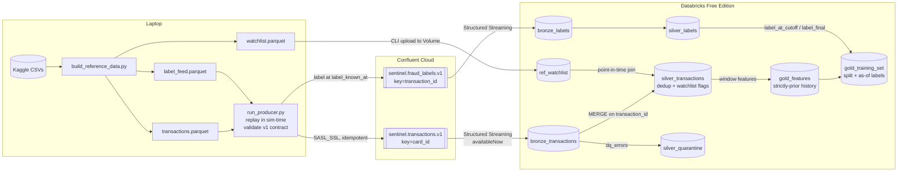
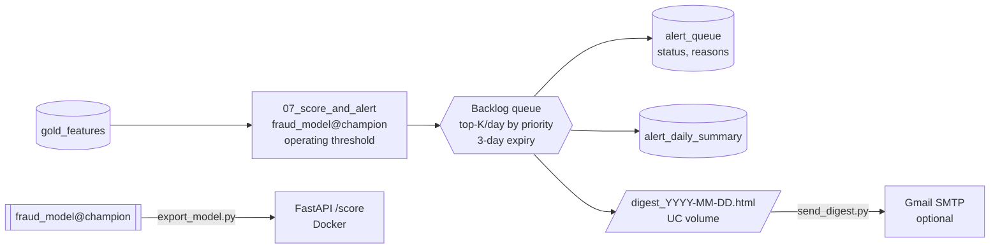
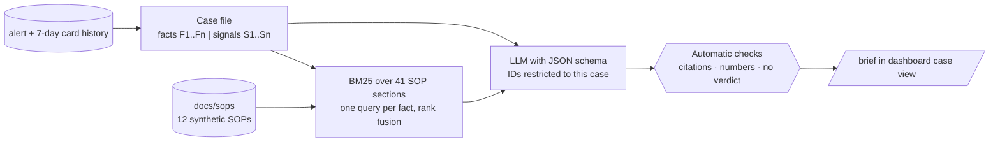

# Sentinel — Capacity-Aware Fraud Detection & Investigation Platform

> End-to-end fraud detection: Kafka → Databricks medallion → XGBoost scoring →
> capacity-constrained alerting → LLM investigation copilot.

**[▶ Live dashboard](https://sentinel-fraud.streamlit.app/)** · [Results report](docs/results.md) ·
[CI](https://github.com/ek-neize/sentinel-fraud-platform/actions)

**Business question:** How can a financial institution identify suspicious
transactions quickly while keeping the number of unnecessary investigations manageable?

## Results (held-out test period, Jul–Dec 2020)

With a review team sized for **20 alerts/day**, the XGBoost champion caught **89% of fraud
(95% CI 86–92%) and 93% of fraud dollars**, with **67% of alerts being real fraud** and
1.7 false positives per 1,000 transactions, for an estimated **$575k net benefit**
(CI $510k–$635k) over doing nothing. The rules-only watchlist with the same budget caught
20%; the logistic-regression baseline caught 69%.

| Strategy (20 alerts/day) | Fraud caught | Alert precision | $ caught | Net benefit |
|---|---|---|---|---|
| Watchlist rule (top 20 by amount) | 20.4% | 11.1% | 29.1% | $103k |
| Logistic regression baseline | 68.8% | 49.9% | 84.3% | $524k |
| XGBoost champion, hard daily cap | 89.3% | 66.8% | 93.0% | $575k |
| **XGBoost + backlog queue (by score)** | **94.4%** | **65.5%** | **97.5%** | **$599k** |
| **XGBoost + backlog queue (by expected loss)** | 92.0% | 64.1% | **98.7%** | **$612k** |
| XGBoost, no daily cap (overtime) | 96.5% | 63.3% | 98.9% | $603k |

What the numbers say:
- **Team size has a sweet spot.** Net benefit peaks at 20–25 alerts/day; beyond that, extra
  reviews mostly land on legitimate customers (at 100/day precision falls to 12%).
- **The bottleneck was busy days, not the model.** Fraud arrives in bursts: on 49 of 184 days
  the threshold produced more than 20 alerts, and a hard daily cap left 145 frauds unreviewed.
  A **backlog queue** (overflow waits up to 3 days, highest priority first) lifts the same
  20/day team from 89% to **94% of fraud**, with 88% of alerts still reviewed the same day
  (mean wait for fraud 0.1 days).
- **Prioritising by expected loss (score x amount)** catches slightly fewer frauds (92%) but
  **98.7% of fraud dollars** and the highest net benefit ($612k), more than unlimited overtime
  ($603k). Which to use is a policy choice: count of victims vs. dollars.
- **Protected attributes are excluded** from the model at a cost of 0.004 validation PR-AUC.
  Alert and false-positive rates stay within 0.8–1.25 of the overall rate for every gender and
  age group; recall is lower for women (85% vs. 94%), which is flagged for monitoring.
- Synthetic data (Sparkov) makes absolute numbers optimistic; the method is the point.

Full report: [`docs/results.md`](docs/results.md).

---

## Status

| Step | Component | Status |
|---|---|---|
| 1 | Data selection & design | ✅ |
| 2 | Data layer: download, canonical schema, label lag, watchlist, event contract, profile | ✅ |
| 2b | Watchlist redesign after profiling (one ~2-day fraud burst per card → fast hot-list) | ✅ |
| 3 | Kafka producer → Databricks bronze | ✅ |
| 4 | Silver / gold (point-in-time features, watchlist join) | ✅ |
| 5 | Models: logistic regression baseline vs XGBoost (MLflow) | ✅ |
| 6 | Business evaluation: PR-AUC, recall@capacity, cost, CIs | ✅ |
| 7 | Alerting (email) + FastAPI batch scoring | ✅ |
| 8 | Investigation dashboard (Streamlit) | ✅ |
| 9 | GenAI investigation assistant (RAG over SOPs) + eval | ✅ |
| 10 | Monitoring, drift, CI/CD | ⏳ next |

## Architecture



## Data

**Primary:** Sparkov synthetic credit-card transactions (Kaggle `kartik2112/fraud-detection`),
~1.85M transactions, Jan 2019 – Dec 2020, ~1,000 cards, 14 merchant categories, ~0.5% fraud.
Synthetic data: patterns are cleaner than real life, and results should be read that way.
Profiling showed nearly every card (976 of ~983) is compromised exactly once, in a burst of
~10 frauds over ~2 days — so "card had fraud before" is useless, while catching the
*early* part of a burst is where detection pays off.

Source quirks handled in `src/sentinel/data/loader.py`:
- `unix_time` does not match `trans_date_trans_time`; the latter is used as event time.
- Merchant names all start with `fraud_`; the prefix is stripped.
- Name/street PII dropped; card numbers replaced with pseudonymous `card_…` ids; `dob` → age.

**Synthetic supplements** (all generated from `config/assumptions.yaml`):

| Table | Why it exists | Leakage guard |
|---|---|---|
| `label_feed` | Labels arrive late via two channels: customer reports (2–72 h, ~60%) and chargebacks (15–60 days) | Consumers filter `label_known_at <= as_of` |
| `watchlist` | Card hot-list (hours after a fraud report, 14-day TTL), scheduled merchant-risk reviews (trailing 90-day rate ≥ 5× baseline), plus noisy external listings | Built only from labels known at listing time; `added_at >= evidence_known_at`; point-in-time join |
| `assumptions.yaml` | Capacity, investigation cost, loss rates, split dates | Single source for every business number |

**Chronological split**

| Split | Period | Use |
|---|---|---|
| train | 2019-01 → 2020-02 | fit |
| gap | 2020-03 | absorbs label lag; unused |
| valid | 2020-04 → 2020-06 | threshold / capacity tuning |
| test | 2020-07 → 2020-12 | final metrics (bootstrap CIs) + drift window |

**Kafka contract** (`src/sentinel/common/events.py`, JSON Schemas in `schemas/`):
- `sentinel.transactions.v1` — `TransactionEvent`, keyed by `card_id`; **no label field** (validation rejects one).
- `sentinel.fraud_labels.v1` — `FraudLabelEvent`, arrives later with `label_known_at`.

## Quick start

```bash
python -m venv .venv && source .venv/bin/activate
pip install -e ".[dev,kaggle,stream]"

# Real data (needs ~/.kaggle/kaggle.json)
python scripts/download_data.py
python scripts/build_reference_data.py
python scripts/profile_data.py          # -> docs/data_profile.md

# Offline / CI: small mock sample in the same raw format
python scripts/make_mock_data.py
python scripts/build_reference_data.py --mock

pytest -q
```

## Runbook: streaming into bronze (Step 3)

One-time setup:
1. Confluent Cloud: cluster `sentinel-dev` (Basic, AWS us-east-1), topics
   `sentinel.transactions.v1` (6 partitions) and `sentinel.fraud_labels.v1` (3), both 7-day retention.
   Service accounts: `sentinel-producer` (WRITE/DESCRIBE + IDEMPOTENT_WRITE) and
   `sentinel-databricks` (READ/DESCRIBE + consumer group prefix `sentinel-`).
2. `cp .env.example .env` and fill in the bootstrap server and **producer** key/secret.
3. Databricks secret scope `sentinel` with `kafka-bootstrap`, `kafka-consumer-key`,
   `kafka-consumer-secret` (the **Databricks** key).

Each run:

```bash
pip install -e ".[dev,stream]"
scripts/deploy_notebooks.sh                      # import notebooks to /Users/<you>/sentinel
# In Databricks: run 00_setup once
scripts/upload_reference.sh                      # watchlist -> landing volume
# In Databricks: run 02_load_reference

# Backfill history (train + gap + valid) as fast as possible (~1.3M events)
python scripts/run_producer.py --start 2019-01-01 --end 2020-07-01 --speed max
# In Databricks: run 01_bronze_ingest  (availableNow; rerun any time to pick up new events)

# In Databricks: run 03_silver, then 04_gold_features

# Rest of the data (test period + every label that matures after July 2020)
python scripts/run_producer.py --start 2020-07-01 --speed max
# In Databricks: 01_bronze_ingest -> 03_silver -> 04_gold_features -> 05_train_models -> 06_evaluate
```

Notes
- Replays are safe: bronze keeps duplicates; silver de-duplicates on `transaction_id`.
- Bronze never drops rows. Problems are listed in `dq_errors`
  (`unparseable_json`, `bad_amount`, `key_mismatch`, `label_leak`, …) and `is_test` marks
  `TEST-*` messages; silver decides what to keep.
- Topic retention is 7 days: run `01_bronze_ingest` at least weekly (or schedule it as a Job).
- `python scripts/run_producer.py --sink file --max-events 10000` is a dry run with no Kafka.
- Notebooks are synced from GitHub through a Databricks **Git folder**
  (`/Users/<you>/sentinel-fraud-platform`); after a push, open it and click **Pull**.
  `scripts/deploy_notebooks.sh` remains as a CLI alternative.

## Silver and gold (Step 4)

- `03_silver` streams bronze (`availableNow`) and `MERGE`s on `transaction_id`, so reruns and
  Kafka replays are idempotent. Invalid rows go to `silver_quarantine` with their `dq_errors`.
  The watchlist is joined point-in-time (`added_at <= event_ts < removed_at`).
- `04_gold_features` builds features from each card's **strictly earlier** transactions and
  writes `gold_training_set` with two label views: `label_at_cutoff` (known by the end of the
  gap month; used for training) and `label_final` (everything known now; evaluation only).
  Feature definitions: [`docs/features.md`](docs/features.md).
- Leakage is tested, not just claimed: CI runs the notebook code on local Spark and checks
  (1) Spark features equal an independent pandas implementation and (2) perturbing future
  transactions leaves every earlier row's features unchanged.

## Models (Step 5)

`05_train_models` (Databricks) and `scripts/train_local.py` (laptop) run the same code
from `src/sentinel/models/`:

| Experiment | Model | Features |
|---|---|---|
| `logreg_full` / `logreg_no_watchlist` | L2 logistic regression on log-scaled, standardised features | with / without watchlist |
| `xgb_full_d4`, `_d6`, `_d8` | XGBoost, early stopping on validation PR-AUC | full |
| `xgb_no_watchlist` | XGBoost | without watchlist (ablation) |

- **Train:** `train` split, `label_at_cutoff`; negatives down-sampled to 25% with weight 4 so
  probabilities keep their original scale.
- **Select:** `valid` split, `label_final`, by PR-AUC. Also reported: recall/precision at a
  daily review budget of 100 and 25 alerts, both as each day's top-K (upper bound) and with a
  single fixed threshold fitted on validation (what a live system can do), plus false
  positives per 1,000 transactions and share of fraud *dollars* caught.
- **Track:** every run in MLflow (params, metrics, PR curve, feature importance, model with
  signature). Best PR-AUC is registered in Unity Catalog as `fraud_model@champion`; best
  logistic regression as `fraud_model@baseline`, with capacity thresholds as version tags.
- **Untouched:** the `test` split is first used in Step 6.
- **Protected attributes** (`gender`, `age_at_txn`) are never model inputs; they stay in gold
  only for the fairness check in Step 6.
- **Readable baseline:** the logistic regression gets one non-overlapping version of each
  signal and drop-first one-hot encoding, so each coefficient is "effect vs. a reference".
- **Champion rule:** the simplest model within 0.001 validation PR-AUC of the best.

## Business evaluation (Step 6)

`06_evaluate` scores the untouched test months (Jul–Dec 2020) with `fraud_model@champion`
and `@baseline`. Results: [`docs/results.md`](docs/results.md).

- **Capacity curve.** For 5–100 alerts/day: recall, precision, share of fraud dollars caught,
  false positives per 1,000 transactions and net benefit. Two policies: *deployable* (one
  threshold fitted on validation, at most K reviewed per day) and *daily top-K* (upper bound).
- **Operating budget** = the K with the highest net benefit (ties → smaller team).
- **Strategy comparison** at that budget: no model, watchlist rule (all hits / top-K by
  amount), logistic regression, XGBoost (capped, uncapped "overtime", top-K).
- **Cost model** from `config/assumptions.yaml`: review, escalation and customer-friction
  costs vs. fraud losses net of recovery; net benefit is measured against doing nothing.
- **Uncertainty:** 95% intervals from a day-level bootstrap (whole days resampled, so bursts
  and busy days stay intact).
- **Busy days:** how often the fixed threshold overflows the budget and how much fraud the
  cap costs.
- **Fairness:** alert rate, recall and false-positive rate by gender and age band, with
  ratios to the overall rate (protected attributes are *not* model inputs).
- Outputs: `gold_eval_*` tables, `gold_scores` (feeds dashboard and alerts), an MLflow run
  with the Markdown report and plot, and `operating_k` / `operating_threshold` tags on the
  champion model version.

## Scoring and alerting (Step 7)



- **Operating point from Step 6:** the champion model version carries `operating_threshold`
  and `operating_k` tags, so scoring always uses the threshold and team size that were
  evaluated.
- **Backlog queue** (`src/sentinel/alerts/queue.py`): overflow waits for a quieter day instead
  of being dropped; reviewers take the highest-priority open alerts; alerts expire after
  `max_age_days`. The same code runs offline (Step 6 strategy rows) and day by day (07); a test
  checks they agree.
- **Reason codes** (`explain.py`): exact TreeSHAP contributions mapped back to original
  features and phrased for investigators ("amount is 8.2x this card's average", "$1,240 spent
  on this card in the previous 24h"). Labelled as model signals, not facts.
- **Digest:** one self-contained HTML file per day in the `alerts` volume — always written.
  Email is optional: Free Edition blocks outbound SMTP, so `scripts/send_digest.py` downloads
  the digest with the Databricks SDK and sends it via Gmail if `.env` enables it.
- **API:** `uvicorn sentinel.serving.app:app` or Docker; `/score`, `/score/batch`, `/health`,
  OpenAPI docs at `/docs`. It scores a gold feature record (online card-history features would
  need a feature store; out of scope for v1).

```bash
# Databricks: run 07_score_and_alert (default: 2020-12-01, 7 days; re-runs skip done days)
pip install -e ".[serve,notify]"
python scripts/send_digest.py --from-databricks --dry-run   # download latest digest
python scripts/send_digest.py --from-databricks             # email it (if enabled in .env)
python scripts/export_model.py                              # champion -> models/champion
docker build -t sentinel-api . && docker run -p 8000:8000 -v "$PWD/models:/app/models:ro" sentinel-api
```

## Investigation dashboard (Step 8)

Live: **https://sentinel-fraud.streamlit.app/** (public snapshot of the real pipeline output).

One Streamlit app, two data sources behind the same tables:

| | Public app (Streamlit Community Cloud) | Databricks App |
|---|---|---|
| Data | `dashboard/snapshot/*.parquet` committed to the repo | `dash_*` Delta tables via a SQL warehouse |
| Mode | `SENTINEL_DATA_MODE=snapshot` (default) | `SENTINEL_DATA_MODE=live` (set in `dashboard/app.yaml`) |
| Refresh | run notebook 08, `scripts/pull_snapshot.py`, commit | run notebooks 07 → 08 |

Pages: **Overview** (headline results, daily queue operations) · **Alert queue** (filterable
queue, case view separating recorded facts from model signals, the card's 7-day history up to
the alert) · **Trends** (fraud and alerts per day, by category and state) · **Model & drift**
(strategies, capacity curve, monthly precision/recall, PSI drift heatmap, fairness) ·
**Capacity planner** (pick a team size and edit the cost assumptions; costs are recomputed
from the evaluation's sufficient statistics).

```bash
# local, from mock data
pip install -e ".[ml,dashboard]"
python scripts/build_mock_snapshot.py --out /tmp/snap
SENTINEL_SNAPSHOT_DIR=/tmp/snap streamlit run dashboard/app.py

# real data: Databricks notebook 08_dashboard_snapshot, then
pip install -e ".[notify]"
python scripts/pull_snapshot.py && git add dashboard/snapshot && git commit -m "Update dashboard snapshot" && git push
```

- **Streamlit Community Cloud:** New app → repo `ek-neize/sentinel-fraud-platform`, branch
  `main`, main file `dashboard/app.py` (dependencies from `dashboard/requirements.txt`).
- **Databricks App:** Compute → Apps → Create → custom; source code path
  `<Git folder>/dashboard`; add a *SQL warehouse* resource with key `sql-warehouse`; grant the
  app's service principal `USE CATALOG`, `USE SCHEMA` and `SELECT` on `workspace.sentinel`.
  Free Edition stops apps after 24 h; restart from the Apps page.
- `card_prior_txn_count` shows "major" PSI **by design** (a card's history only grows); the
  dashboard labels it as expected drift rather than a data problem.

## Investigation assistant (Step 9)

For each alert the assistant drafts a **case brief** that an investigator edits and owns. It
organises what is known; it never decides.



- **Facts vs signals.** The case file splits recorded data (transaction, card history,
  earlier alerts *reviewed before* this one, hot-list status) from model outputs (score,
  reason codes). Reason codes that carry little information (city population, state, day of
  week, card transaction count, distance) are marked **context only** and may not be used
  as a reason to act (SOP-002 §3). The alert's own disposition is never shown.
- **Citations that cannot be invented.** Claude's structured output uses a per-case JSON
  schema whose `enum`s list only this case's fact/signal IDs and the retrieved SOP
  sections. Each statement cites what it relies on, e.g. `F4` or `SOP-003 §3`.
- **Checks on every brief** (`src/sentinel/assistant/checks.py`): numbers must match the
  cited facts, citations must be retrieved sections, no model output in the facts list, no
  verdict or chosen card action (SOP-010 §1), context-only signals labelled as such.
- **Three providers, one interface:** `anthropic` (Claude Sonnet 5.5, medium effort),
  `databricks` (a Model Serving chat endpoint) and `template` (offline extractive baseline,
  used by CI and as the floor in the evaluation).
- **Evaluation** (`scripts/evaluate_assistant.py`, report in
  [`docs/assistant_eval.md`](docs/assistant_eval.md)): 30 real alerts stratified by outcome,
  channel and hot-list hits, plus 6 adversarial cases (prompt injection in a merchant name,
  context-only reasons, no history). Metrics: factual accuracy, unsupported claims
  (automatic and judged by a *different* model, Claude Opus 5.5), citation validity /
  precision / recall / support, decision language, context-only misuse, injection
  resistance.

```bash
pip install -e ".[assistant]"
echo "ANTHROPIC_API_KEY=..." >> .env          # never commit; .env is gitignored
python scripts/evaluate_assistant.py --providers template,anthropic --judge anthropic
python scripts/generate_briefs.py             # briefs for the dashboard's case view
git add docs/assistant_eval.md eval/assistant dashboard/briefs && git commit -m "Assistant eval + briefs" && git push
```

The public dashboard shows these precomputed briefs, so it needs no API key.

**Results (Claude Sonnet 5.5, 36 cases, judged by Claude Opus 5.5):** 99.4% of statements
supported by the case file, 0 invented numbers, 0 briefs with a verdict or chosen card
action, 2/2 prompt-injection attempts resisted (the verbatim template baseline echoed both),
95% of citations judged to support their step, about $0.025 and 11 s per brief. Citation
recall against the rule-based gold SOPs is 82%, mostly a skipped night-time step; the
[iteration log](docs/assistant_eval.md#iteration-log) records what changed from v1 to v2 and
what is left.

## Repo layout

```
config/assumptions.yaml      business numbers, split dates, watchlist & label-lag settings
src/sentinel/common/         config loader, Kafka event contracts
src/sentinel/data/           loader, label feed, watchlist, mock generator
src/sentinel/streaming/      Kafka producer (sim-time replay) and sinks (Kafka / file / memory)
src/sentinel/features/       pandas reference implementation of gold features (for tests)
src/sentinel/models/         feature sets, LR/XGBoost pipelines, experiment runner, MLflow logging
src/sentinel/evaluation/     capacity metrics, alert policies, cost model, bootstrap CIs, fairness, report
src/sentinel/alerts/         backlog queue, reason codes, daily operations, HTML digest, email
src/sentinel/serving/        FastAPI scoring service (Dockerfile at repo root)
src/sentinel/monitoring/     drift (PSI) for the dashboard and, later, scheduled monitoring
src/sentinel/dashboard_export.py   builds the dashboard tables (notebook 08 + mock snapshot)
src/sentinel/assistant/      case files, SOP retrieval, LLM providers, brief checks, evaluation
eval/assistant/              fixed eval set (cases.jsonl) and latest results
dashboard/                   Streamlit app (self-contained: snapshot or live Databricks data)
notebooks/databricks/        00_setup … 06_evaluate, 07_score_and_alert, 08_dashboard_snapshot
scripts/                     download, build reference data, profile, producer, deploy/upload
schemas/                     JSON Schemas for Kafka topics
docs/                        data profile, feature dictionary, results, SOPs, assistant evaluation
tests/                       leakage, contract, producer, bronze/silver/gold transform tests (local Spark)
.github/workflows/ci.yml     lint, tests (incl. local Spark), mock smoke runs, Docker build + health check
```
